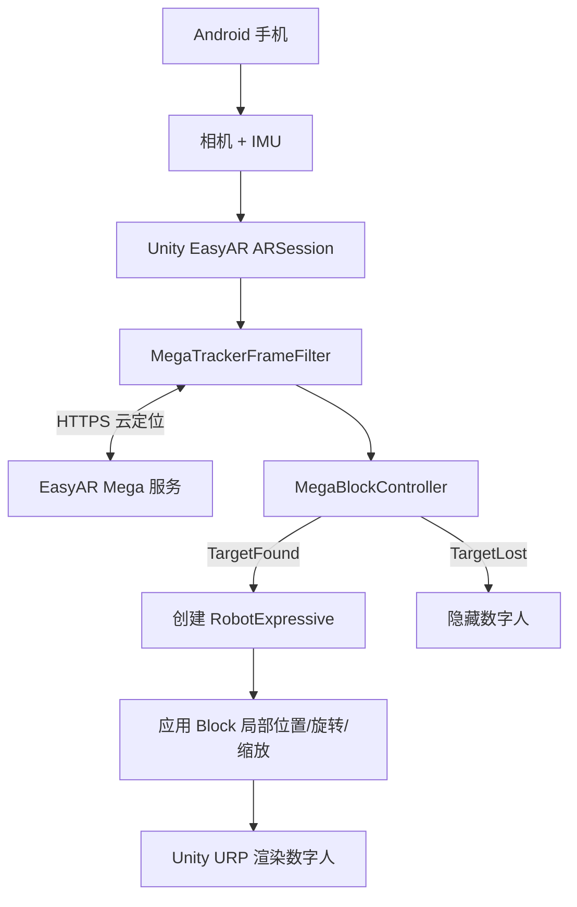
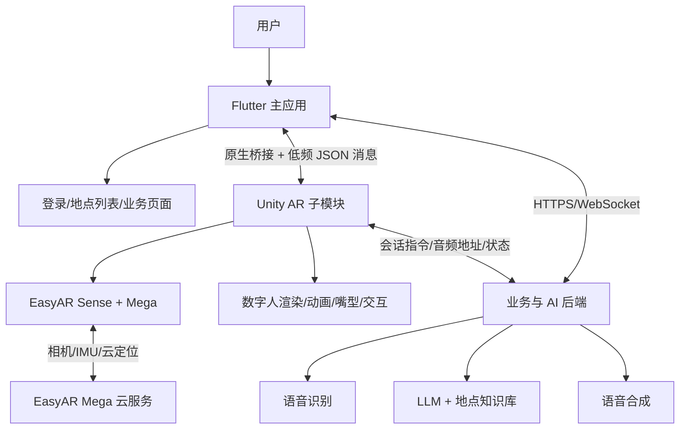

# EasyAR AI 数字人项目当前进度与实现架构

## 1. 文档信息

- 记录日期：2026-09-02
- 工程目录：`D:\work\build_work\APP_data\DATA_PERSON\My project (2)`
- 当前平台：Android
- 当前实现主体：Unity 独立 APK
- 目标产品架构：Flutter 主应用 + Unity AR 子模块 + EasyAR Mega + AI 对话后端
- 当前结论：机器人模型已配置进运行时场景，新 APK 已构建成功，等待 Android 真机现场验证

## 2. 项目目标

在指定真实地点使用 EasyAR Mega 完成视觉空间定位。定位成功后，Unity 在事先人工摆放的空间坐标显示一个风格化 3D 数字人。后续接入语音识别、AI 问答和语音合成，使用户能够在现场与数字人对话。

最终目标流程：

```text
用户进入 Flutter 应用
  -> 选择地点或数字人服务
  -> 打开 Unity AR 页面
  -> EasyAR 使用相机和运动传感器进行 Mega Block 云定位
  -> Unity 获得该地点的 Block 空间坐标系
  -> Unity 在预设局部坐标创建数字人
  -> 用户语音输入
  -> AI 后端执行 ASR、LLM/RAG、TTS
  -> Unity 播放回答语音、动作、表情和嘴型
```

## 3. 当前完成状态

| 模块 | 状态 | 说明 |
| --- | --- | --- |
| Unity Android 工程 | 已完成基础配置 | Unity 6.3 LTS，可生成 ARM64 APK |
| EasyAR Sense | 已接入 | 相机、运动跟踪和许可证构建校验已配置 |
| EasyAR Mega | 已接入 | 使用 Mega Block 云定位流程 |
| Mega Studio 登录 | 已完成 | 已能登录并加载地图 |
| 地图加载 | 已完成 | 当前地图对象为 `Block_test_1` |
| 地图内人工摆放 | 已完成首版 | RobotExpressive 已在 MegaAuthoring 中人工调整位置、朝向和缩放 |
| GLB 模型导入 | 已完成 | 使用 glTFast 6.20.0 解决旧版多网格蒙皮导入异常 |
| 运行时模型配置 | 已完成 | `SampleScene` 已引用 RobotExpressive 模型及其 Block 局部 Transform |
| Android APK 构建 | 已完成 | 2026-09-02 构建成功，0 个构建错误 |
| Android 现场验证 | 待完成 | 当前没有连接测试手机，尚未验证新 APK 中机器人是否在真实地点正确出现 |
| 机器人动画控制 | 未完成 | 模型包含动画，但尚未实现 Idle、Listening、Thinking、Speaking 状态机 |
| 语音与 AI 对话 | 未开始 | 尚未接入 ASR、LLM/RAG、TTS |
| 嘴型与表情 | 未开始 | 尚未实现音量驱动或 viseme 时间轴 |
| Flutter 集成 | 未开始 | 当前仍是 Unity 独立 APK，尚未导出 Unity as a Library |

## 4. 当前使用的技术与版本

| 技术 | 当前版本或配置 | 用途 |
| --- | --- | --- |
| Unity | `6000.3.23f1` | AR 会话、3D 渲染、数字人、Android 构建 |
| Universal Render Pipeline | `17.0.1` | 移动端渲染管线 |
| EasyAR Sense Unity Plugin for Mega | `4003.1.0+5282.db47c2304` | 相机、AR 会话、运动跟踪 |
| EasyAR Mega | `2.14.0+5282.db47c2304` | Mega Block 云定位与空间坐标输出 |
| EasyAR Mega Studio | `2.13.1+5282.db47c2304` | Unity 内地图浏览、标注和内容摆放 |
| glTFast | `6.20.0` | 导入 `.glb`/glTF 模型、蒙皮、材质和动画 |
| Android | ARM64，最低 API 25 | 当前真机测试平台 |
| Flutter | 尚未接入 | 后续作为产品主应用和普通业务 UI |
| AI 后端 | 尚未选型接入 | 后续提供 ASR、LLM/RAG、TTS |

## 5. 当前工程结构

```text
My project (2)
|-- Assets
|   |-- Models
|   |   `-- RobotExpressive_aa2603d917384b68bb4a086f32dabe83.glb
|   |-- Scenes
|   |   |-- MegaAuthoring.unity       # 编辑器地图浏览和人工摆放
|   |   `-- SampleScene.unity         # Android APP 实际运行场景
|   |-- Scripts
|   |   `-- EasyARCloudBlockBootstrap.cs
|   `-- Editor
|       |-- MegaAuthoringSetup.cs
|       `-- AndroidApkBuilder.cs
|-- Packages
|   |-- manifest.json
|   `-- com.unity.cloud.gltfast-6.20.0.tgz
|-- Builds
|   |-- EasyARCloudBlockTest-debug.apk
|   `-- android-build-summary.txt
`-- DOC
    |-- flutter-unity-easyar-ai-digital-human-plan.md
    `-- current-progress-and-architecture-2026-09-02.md
```

## 6. 当前可运行架构

当前 APK 尚未集成 Flutter 和 AI，实际运行链路如下：



对应代码流程位于 `Assets/Scripts/EasyARCloudBlockBootstrap.cs`：

1. 创建 `MegaBlock_MotionTracking_Inertial` ARSession。
2. 真机使用 `MegaLocationInputMode.Onsite`。
3. 配置 Mega 服务和目标 Block。
4. `TargetFound` 时将数字人实例化为 Block 的子对象。
5. 对实例应用 Block 局部 Transform。
6. `TargetLost` 时隐藏数字人，重新定位后恢复显示。
7. 如果 `digitalHumanPrefab` 为空，才会创建绿色测试方块作为回退内容。

当前 `digitalHumanPrefab` 已配置，因此新 APK 定位成功后应显示机器人，不再显示绿色测试方块。

## 7. EasyAR 定位与数字人放置原理

### 7.1 建图和定位

EasyAR Mega 的地图记录了真实环境中的视觉特征。手机在现场拍摄环境后，Mega 服务将当前相机画面与云端 Block 地图匹配，并返回手机在该 Block 坐标系中的位姿。

EasyAR 负责回答“手机和地图之间的位置关系”，但不负责设计数字人，也不负责 AI 对话。

### 7.2 Block 坐标系

定位成功后，`MegaBlockController.transform` 相当于当前真实地点的 Unity 空间原点。数字人作为它的子对象，使用局部位置、局部旋转和局部缩放进行放置。

当前机器人参数：

```text
Block: Block_test_1
Position: (0.10, -0.481, 1.373)
Rotation Euler: (0, 180, 0)
Scale: (0.5, 0.5, 0.5)
```

这组参数来自 Unity 中当前人工摆放结果，并已写入 `Assets/Scenes/SampleScene.unity`。

### 7.3 MegaAuthoring 与运行时场景的关系

`MegaAuthoring.unity` 是编辑器工具场景，用于：

- 浏览 EasyAR Mega 地图；
- 查看地图坐标方向和环境结构；
- 创建标注或辅助方块；
- 手工拖入数字人并调整位置、旋转、缩放。

它不会直接进入当前 Android 安装包。Build Settings 当前只包含 `SampleScene.unity`。

当前实现使用以下同步方式：

```text
MegaAuthoring 中人工摆放模型
  -> 读取模型相对 Block_test_1 的局部 Transform
  -> 将模型引用和 Transform 写入 SampleScene
  -> Android 构建包含 SampleScene 和模型资源
  -> 真机定位成功后按同一局部 Transform 创建模型
```

因此，未来若在 MegaAuthoring 中重新移动机器人，还需要重新同步 Transform 并构建 APK。正式多地点版本应增加可版本化的地点配置或 EMA 标注导出流程，避免把每个位置写死在场景中。

## 8. 数字人模型信息

- 模型文件：`Assets/Models/RobotExpressive_aa2603d917384b68bb4a086f32dabe83.glb`
- 模型类型：风格化 RobotExpressive 机器人，不是写实人物
- 格式：glTF 2.0 Binary (`.glb`)
- 内容：14 个网格、2 套蒙皮、3 个材质、14 个动画
- 模型 SHA-256：`047F5E5FB3BB6D378BD1DF16CA6137F2A596C99B3A1B5690B4020C05AAF6F319`

最初使用 glTFast 6.14.1 导入时，多网格蒙皮触发骨骼权重 Job 异常。工程已升级到 Unity 官方 glTFast 6.20.0，模型现已作为可用 GameObject/Prefab 资源导入。

当前只是“数字人载体已显示”的阶段。模型动画、对话状态、语音播放、嘴型和表情控制尚未接入。

## 9. Android 构建记录

- 构建结果：`Succeeded`
- 构建时间：2026-09-02 16:50
- 构建耗时：`00:12:01.1911693`
- 构建错误：`0`
- 构建警告：`972`
- APK 实际文件大小：`178,837,470` 字节，约 `170.6 MiB`
- 包名：`com.example.virtual_agent`
- 产品版本：`0.1.0`
- 输出文件：`Builds/EasyARCloudBlockTest-debug.apk`
- APK SHA-256：`88431D9440A46518D2DB778A2135FF0B4E003B1E9F61918099C6AF093E52AB37`

当前 APK 是 Development Build，并允许调试，仅用于开发验证，不是正式发布包。

## 10. 真机测试方法

### 10.1 安装

连接 Android 手机并开启 USB 调试：

```powershell
$unityAdb = "C:\Program Files\Unity\Hub\Editor\6000.3.23f1\Editor\Data\PlaybackEngines\AndroidPlayer\SDK\platform-tools\adb.exe"
& $unityAdb devices
& $unityAdb install -r "D:\work\build_work\APP_data\DATA_PERSON\My project (2)\Builds\EasyARCloudBlockTest-debug.apk"
```

### 10.2 现场验证

1. 打开 APP并允许相机权限。
2. 保持手机联网。
3. 到 `Block_test_1` 对应的真实建图地点。
4. 将相机对准建图时包含的环境结构和纹理。
5. 缓慢平移和转动手机，避免快速晃动。
6. 定位成功后检查机器人是否出现在指定位置。
7. 从不同角度移动，检查机器人是否稳定固定在真实空间中。
8. 暂时遮挡或离开地图区域，检查丢失定位时机器人是否隐藏。
9. 回到有效区域，检查重新定位后机器人是否恢复。

### 10.3 日志检查

```powershell
& $unityAdb logcat | Select-String "EasyAR Block|EasyAR Mega localization|Unity"
```

重点日志：

```text
EasyAR Block found
EasyAR Block lost
EasyAR Mega localization
```

## 11. 目标总体架构

Flutter 可以作为最终应用主体，但 EasyAR、相机 AR 会话和数字人 3D 渲染继续由 Unity 负责。推荐使用 Unity as a Library，将 Unity AR 页面作为 Flutter Android 应用中的全屏原生页面。



模块职责：

| 模块 | 主要职责 |
| --- | --- |
| Flutter | 应用入口、登录、地点选择、普通业务 UI、路由和账号体系 |
| Unity | AR 全屏页面、数字人渲染、动画、嘴型、空间交互 |
| EasyAR | 相机图像、运动跟踪、Mega Block 云定位和空间坐标 |
| AI 后端 | ASR、LLM/RAG、TTS、会话状态、内容安全和临时令牌 |
| 原生桥接层 | Flutter 与 Unity 生命周期、页面切换和消息传递 |

## 12. AI 数字人后续实现原理

推荐的语音交互链路：

```text
Unity/Flutter 采集麦克风音频
  -> 流式 ASR 得到用户文本
  -> LLM/RAG 根据地点知识生成回答
  -> TTS 生成回答音频
  -> 返回文本、音频、情绪、动作和嘴型信息
  -> Unity 播放音频并驱动数字人动画与嘴型
```

建议的最小状态机：

| 状态 | 数字人表现 |
| --- | --- |
| Idle | 待机动作和轻微视线变化 |
| Listening | 面向用户并显示倾听动作 |
| Thinking | 播放思考动作，等待 AI 响应 |
| Speaking | 播放 TTS、动作、表情和嘴型 |
| Lost | EasyAR 定位丢失，暂停交互或隐藏 |
| Error | 网络、权限或服务错误提示 |

MVP 可以先使用音量驱动嘴型，正式版本再使用 viseme/音素时间轴提高同步精度。

## 13. 当前限制和风险

1. 新 APK 尚未在真实建图地点验证，当前位置和缩放是否合适仍需以真机画面为准。
2. RobotExpressive 虽包含动画，但当前运行时没有明确的动画状态机，首次测试可能只显示静态默认姿势。
3. 当前地点和模型引用直接保存在 `SampleScene`，还没有地点配置后台或多锚点管理。
4. Flutter 尚未集成，当前 APK 只能验证 Unity + EasyAR + 模型链路。
5. 当前客户端脚本和场景中包含长期 EasyAR 服务凭据。正式版本不得继续这样发布，应改为后端签发短期 Token，并轮换已经用于测试的凭据。
6. 当前包名是测试包名，Flutter 集成前必须统一最终 Android `applicationId` 与 EasyAR License。
7. 构建存在 972 条警告。虽然当前构建成功，但正式集成前需要分类清理，确认没有 ABI、权限、图形 API 或废弃接口风险。
8. 当前 APK 约 170.6 MiB，后续需要检查模型、纹理、IL2CPP 和调试符号带来的体积。

## 14. 下一步优先级

### P0：验证当前 APK

- 安装到 Android 真机；
- 在 `Block_test_1` 现场完成定位；
- 验证位置、大小、朝向、遮挡和稳定性；
- 保存截图、录屏和关键日志；
- 根据现场结果微调 Transform 并重新构建。

### P1：让数字人具有基础生命感

- 确认 14 个动画片段名称和可用性；
- 建立 Animator Controller；
- 实现 Idle、Listening、Thinking、Speaking；
- 添加 AudioSource；
- 先实现简单音量驱动嘴型或灯光反馈。

### P2：验证 Flutter + Unity 集成

- 创建最小 Flutter Android 工程；
- 将 Unity 导出为 Unity as a Library；
- 从 Flutter 打开和关闭全屏 Unity AR 页面；
- 验证相机生命周期、前后台切换和连续进入退出；
- 定义带版本号的双向 JSON 协议。

### P3：接入 AI 对话

- 选择或实现 ASR、LLM/RAG、TTS 后端；
- 建立流式会话和中断机制；
- 将对话状态映射到 Animator；
- 增加超时、重试、弱网和内容安全处理。

### P4：多地点与生产化

- 将 Block ID、锚点 Transform、数字人和对话配置数据化；
- 建立 Mega Studio/EMA 内容制作和发布规范；
- 使用短期 Token 替代客户端长期密钥；
- 完成 Android 签名、AAB、隐私权限和设备兼容性测试。

## 15. 当前验收清单

- [x] EasyAR Unity 插件安装
- [x] EasyAR Mega Studio 可登录
- [x] `Block_test_1` 地图可加载
- [x] RobotExpressive GLB 成功导入
- [x] RobotExpressive 可在 MegaAuthoring 中人工摆放
- [x] 运行时场景绑定 RobotExpressive
- [x] Block 局部 Transform 已同步
- [x] Android ARM64 Development APK 构建成功
- [ ] 新 APK 安装到真机
- [ ] 现场定位后机器人正确出现
- [ ] 机器人位置、大小和朝向验收
- [ ] 动画状态机完成
- [ ] AI 语音对话完成
- [ ] Flutter + Unity 集成完成

## 16. 官方参考资料

- EasyAR 下载页：<https://www.easyar.cn/view/download.html>
- Mega Unity 内容制作环境配置：<https://www.easyar.cn/doc/zh-cn/develop/wechat/mega/content-unity-setup.html>
- Mega Unity 简单内容制作流程：<https://www.easyar.cn/doc/zh-cn/develop/wechat/mega/content-simple.html>

## 17. 当前阶段结论

当前已经从“EasyAR 定位后显示绿色测试方块”推进到“EasyAR 定位后实例化指定 RobotExpressive 模型”的可构建阶段。模型、位置和 Android APK 均已准备完成，下一项决定性工作不是继续改代码，而是在 `Block_test_1` 的真实地点完成新 APK 真机验收。

真机空间显示通过后，再依次增加动画、语音 AI 和 Flutter 集成，可以保持每个阶段的故障边界清晰。
