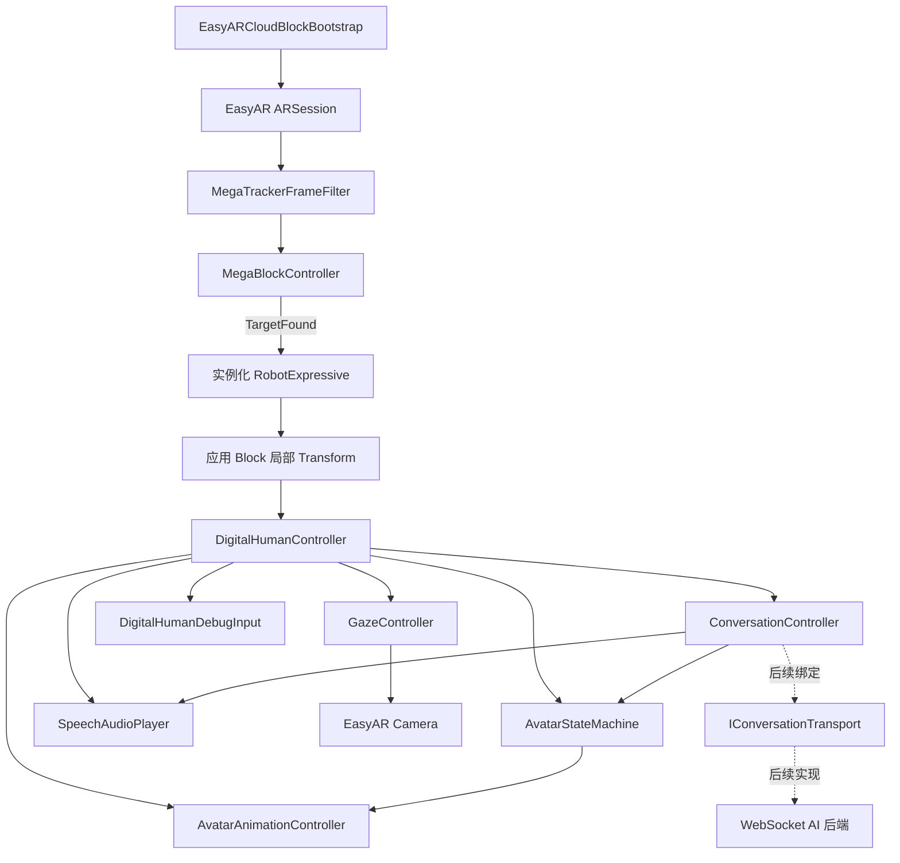

# EasyAR AI 数字人项目当前进度与实现架构

## 1. 文档信息

- 记录日期：2026-09-04
- 工程目录：`D:\work\build_work\APP_data\DATA_PERSON\My project (2)`
- 当前阶段：先完成 Unity 独立 Android AR 验证
- 最终架构：Flutter 主应用 + Unity as a Library + EasyAR Mega + WebSocket AI 后端
- 当前模型：RobotExpressive GLB
- 当前地图：`Block_test_1`

## 2. 项目目标

在 Flutter 手机 App 中嵌入全屏 Unity AR 页面。EasyAR 在真实地点完成 Mega Block 定位后，数字人固定出现在预先人工摆放的空间位置，并能待机、看向镜头、听用户说话、连接 WebSocket AI 后端，在回答时同步播放语音、口型、表情和动作。

当前不做 Flutter 集成，先在 Unity 中验证以下闭环：

```text
EasyAR 现场定位
  -> 找到 Block_test_1
  -> 创建并摆放 RobotExpressive
  -> 播放待机动画
  -> 数字人头部看向 AR 相机
  -> 切换 Listening / Thinking / Speaking 状态
  -> 播放手势
  -> 后续接入麦克风、WebSocket 和 TTS
```

## 3. 当前技术基线

| 项目 | 当前选型 |
| --- | --- |
| Unity | `6000.3.23f1` |
| 渲染管线 | URP `17.0.1` |
| Android | ARM64，最低 API 25 |
| EasyAR Sense for Mega | `4003.1.0+5282.db47c2304` |
| EasyAR Mega | `2.14.0+5282.db47c2304` |
| EasyAR Mega Studio | `2.13.1+5282.db47c2304` |
| GLB 导入 | glTFast `6.20.0` |
| 当前模型 | RobotExpressive GLB，14 个动画片段 |
| 当前运行形态 | Unity Android Development APK |
| 最终运行形态 | Flutter + Unity as a Library |
| AI 通信 | WebSocket/WSS，尚未接入实际后端 |

## 4. 已完成内容

### 4.1 EasyAR 与空间放置

- 已保留现有 `EasyARCloudBlockBootstrap` 的 ARSession、MegaTracker 和 Block 创建流程。
- 编辑器使用 `Simulator`，Android 真机使用 `Onsite`。
- `TargetFound` 时实例化 RobotExpressive，并挂到 `MegaBlockController.transform` 下。
- `TargetLost` 时隐藏数字人；重新定位后恢复显示。
- 未配置模型时仍保留绿色方块作为定位回退测试内容。
- EasyAR 定位逻辑与数字人会话逻辑相互独立。

当前人工摆放参数：

```text
Block: Block_test_1
Position: (0.10, -0.481, 1.373)
Rotation: (0, 180, 0)
Scale: (0.5, 0.5, 0.5)
```

这些参数已经写入 `Assets/Scenes/SampleScene.unity`。运行时数字人是 Block 的子对象，因此位置是 Block 局部坐标，不是手机相机坐标。

### 4.2 数字人运行时骨架

已实现以下组件：

| 组件 | 职责 |
| --- | --- |
| `DigitalHumanController` | 数字人总入口，初始化并协调其他组件 |
| `AvatarStateMachine` | 分别保存定位状态和会话状态 |
| `AvatarAnimationController` | 将会话状态和语义手势映射到 Animator 状态 |
| `GazeController` | 查找 Head 骨骼并在 `LateUpdate` 中受限地看向 AR 相机 |
| `SpeechAudioPlayer` | 播放 AudioClip 或完整 PCM16 音频缓冲 |
| `ConversationController` | 驱动 Listening、Thinking、Speaking、Idle 和 Error |
| `IConversationTransport` | WebSocket 传输层接口，便于后续替换实现 |
| `DigitalHumanDebugInput` | Unity/Android 开发测试输入 |

定位状态：

```text
Locating -> Found -> Lost / Error
```

会话状态：

```text
Idle -> Listening -> Thinking -> Speaking -> Idle
                              \-> Error
```

两套状态分开是必要的：短暂丢失定位时，不能把 AI 会话状态直接清空；当前实现会暂停语音、隐藏人物，重新定位后恢复。

### 4.3 Animator 与现有动作

已生成：

```text
Assets/DigitalHuman/RobotExpressive.controller
```

Animator 状态：

```text
Idle
Listening
Thinking
Speaking
Error
Wave
Yes
No
ThumbsUp
```

RobotExpressive 没有专门的倾听、思考和说话动画，因此第一阶段这些状态暂时复用 `Idle`。手势状态使用 GLB 中真实的 `Wave`、`Yes`、`No`、`ThumbsUp` 动画。手势播放结束后会回到当前会话状态；定位丢失导致对象停用时也会正确终止手势，避免重新显示后卡在手势状态。

模型中已确认的 14 个动画片段：

```text
Dance, Death, Idle, Jump, No, Punch, Running,
Sitting, Standing, ThumbsUp, Walking, WalkJump, Wave, Yes
```

### 4.4 注视、音频与会话边界

- 当前 RobotExpressive 使用 Generic 骨骼，程序会从蒙皮骨骼中寻找名为 `Head` 的骨骼。
- 注视限制默认为左右 55 度、上下 25 度、每秒 120 度平滑旋转。
- `SpeechAudioPlayer` 与最终口型组件共用同一个 `AudioSource`。
- 当前支持完整 `AudioClip` 和完整 PCM16 缓冲播放。
- 流式 PCM 环形缓冲、麦克风采集、WebSocket 重连、打断协议和口型尚未实现。
- WebSocket 仅定义了 `IConversationTransport`，没有伪造后端或写死协议实现。

## 5. 当前 Unity 内部架构



主要运行入口：

```text
Assets/Scripts/EasyARCloudBlockBootstrap.cs
```

数字人模块：

```text
Assets/Scripts/DigitalHuman/
Assets/Scripts/DigitalHuman/Conversation/
Assets/DigitalHuman/RobotExpressive.controller
```

编辑器配置入口：

```text
Tools/Digital Human/Configure RobotExpressive Prototype
```

该菜单会检查模型、生成或更新 Animator Controller，并把模型和 Controller 绑定到 `SampleScene`，不会替换 EasyAR 原有定位逻辑。

## 6. 开发测试操作

Unity Editor 键盘：

| 按键 | 操作 |
| --- | --- |
| `1` | Idle |
| `2` | Listening |
| `3` | Thinking |
| `4` | Speaking |
| `W` | Wave |
| `Y` | Yes |
| `N` | No |
| `T` | ThumbsUp |

Android Development APK：

| 手势 | 操作 |
| --- | --- |
| 单指轻触 | 依次切换 Idle、Listening、Thinking、Speaking |
| 双指轻触 | 播放 Wave |

移动端触摸按一次完整触摸序列判定，双指不要求两根手指在同一帧同时按下，并避免一次双指操作触发两次。

## 7. 2026-09-04 验证记录

### 7.1 Unity 编译

```text
status: completed
failed: false
errors: []
```

### 7.2 组件烟雾测试

临时实例化 RobotExpressive 并初始化数字人组件，结果：

```text
state=Thinking
animator=True
thinking=True
gaze=True
audio=True
conversation=True
```

### 7.3 Unity Play Mode

- `SampleScene` 可以进入 Play Mode。
- EasyAR Sense 初始化成功。
- Mega 在编辑器中按预期使用 Simulator 模式。
- 无编译错误、空引用异常或新增脚本运行时错误。
- 编辑器没有现场地图画面，因此定位返回 `NotFound`，该结果不能代替 Android 现场验收。
- 测试完成后已退出 Play Mode，并恢复原先打开的 `MegaAuthoring` 场景。

### 7.4 Android APK

```text
Result: Succeeded
Build time: 2026-09-04 13:35:10 (Asia/Shanghai)
Duration: 00:03:00.1111440
APK size: 171,214,616 bytes (约 163.28 MiB)
Warnings: 2
Build report errors: 1
SHA-256: 46048453390A9623313DE3B8528AE2A01F364344BFDE6AFCC4CC0D45DC897900
```

Unity 的最终结果为 `Succeeded`，脚本重新编译错误为 0，Unity Console 错误为 0。Build Report 中的 1 条错误来自 Unity 编辑器附带的 AI Assistant 请求 `generators.ai.unity.com` 时发生证书验证失败，不是 EasyAR、数字人脚本、Gradle 或 APK 生成失败。

APK 已继续通过 Android 工具检查：

```text
APK Signature Scheme v2: verified
Package: com.example.virtual_agent
Version: 0.1.0 (versionCode 1)
Min SDK: 25
Target SDK: 36
Launch Activity: com.unity3d.player.UnityPlayerGameActivity
Native ABI: arm64-v8a
```

## 8. Android 现场验收流程

1. 连接 Android ARM64 手机并开启 USB 调试。
2. 安装 `Builds/EasyARCloudBlockTest-debug.apk`。
3. 打开 App，允许相机权限并保持网络可用。
4. 到 `Block_test_1` 的实际建图地点。
5. 缓慢移动相机观察建图区域，直到日志出现 `EasyAR Block found`。
6. 检查 RobotExpressive 是否出现在指定位置、大小和朝向是否正确。
7. 从多个方向移动手机，检查人物是否固定在真实空间而不是跟随屏幕。
8. 检查 Idle 是否持续播放，头部是否在角度限制内看向相机。
9. 单指轻触切换四种会话状态，双指轻触测试 Wave。
10. 暂时离开有效区域，验证人物隐藏；重新定位后验证人物恢复且动画状态正常。

ADB 路径：

```powershell
$unityAdb = "C:\Program Files\Unity\Hub\Editor\6000.3.23f1\Editor\Data\PlaybackEngines\AndroidPlayer\SDK\platform-tools\adb.exe"
& $unityAdb devices -l
& $unityAdb install -r "D:\work\build_work\APP_data\DATA_PERSON\My project (2)\Builds\EasyARCloudBlockTest-debug.apk"
```

本次记录时没有检测到已连接的 Android 设备，因此尚未执行安装和现场验证。

## 9. 后续 WebSocket 方案

Unity 在 AR 页面内直接处理麦克风和 TTS 音频，Flutter 与 Unity 只交换低频 JSON，不传实时 PCM：

```text
Unity 麦克风
  -> PCM16 小帧
  -> WebSocket/WSS
  -> ASR
  -> LLM/RAG
  -> TTS
  -> WebSocket 音频
  -> Unity AudioSource
  -> 口型、表情和动作
```

后端在接入前必须明确：

- WebSocket 地址和鉴权方式；
- JSON 事件样例；
- PCM 采样率、位深、声道数和分帧方式；
- TTS 返回格式；
- 心跳、超时、重连和用户打断协议；
- `emotion`、`gesture` 等语义指令集合。

后端应发送 `emotion=joy`、`gesture=greeting` 这类语义，不应直接依赖 Unity 动画片段名称。

## 10. Flutter 边界

Flutter 后续只负责登录、地点选择、业务页面、Token 和打开或关闭 AR 页面。进入 Unity 时传递低频配置，例如：

```json
{
  "version": 1,
  "placeId": "Block_test_1",
  "avatarId": "robot_expressive",
  "websocketUrl": "wss://example.invalid/conversation",
  "accessToken": "short-lived-token"
}
```

Unity 负责 EasyAR、相机、空间定位、3D 数字人、Animator、注视、麦克风、TTS 播放和口型。等 Unity 真机闭环稳定后，再导出 Unity as a Library 接入 Flutter。

## 11. 安全说明

- 当前开发场景仍包含用于测试的长期 EasyAR 服务凭据。
- 本文档不记录这些凭据的具体值。
- 正式发布前必须改为后端签发短期 Token，并轮换已经进入开发工程或测试包的长期凭据。
- Flutter 最终 `applicationId` 必须与 EasyAR License 配置一致。

## 12. 当前未完成项

- [ ] Android 手机安装最新 APK
- [ ] 在 `Block_test_1` 现场定位成功
- [ ] 验证数字人的位置、大小、朝向和空间稳定性
- [ ] 验证 Idle、头部注视、触摸状态切换和手势返回
- [ ] 接入真实 WebSocket 地址和协议
- [ ] 实现麦克风 PCM16 流式采集
- [ ] 实现 TTS 流式播放、重连、超时和打断
- [ ] 为 RobotExpressive 增加临时音量反馈或口型方案
- [ ] 导入一个 Rocketbox Facial FBX 验证 Viseme
- [ ] Unity 稳定后导出 Unity as a Library 并接入 Flutter

## 13. 下一步实施顺序

1. 连接手机并完成 `Block_test_1` 现场定位验收。
2. 根据现场画面微调 Position、Rotation 和 Scale。
3. 为 Listening、Thinking、Speaking 补充可区分的临时动画表现。
4. 在后端协议明确后实现 `WebSocketConversationTransport`。
5. 接入麦克风、流式 TTS、重连、超时和打断。
6. 接入口型或 RobotExpressive 临时音量反馈。
7. 使用 Rocketbox Facial 验证真实 Viseme 口型。
8. 最后进行 Flutter + Unity as a Library 集成。

当前最重要的验收点仍是 Android 现场定位。只有确认数字人能稳定固定在 `Block_test_1` 的真实空间位置后，才进入 WebSocket 和 Flutter 阶段。
